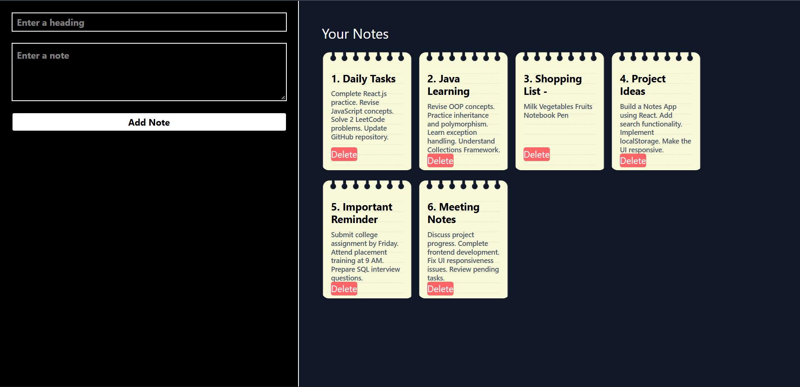

# Project title :- Notes App

## Project Description :-
The project is designed for daily use , allowing users to create and manage their notes. Users can also delete the notes they hava created whenever they want.

### Main Functionalities
- Create Notes: Users can create new notes by adding a title and description.
- View Notes: Users can view all their created notes.
- Delete Notes: Users can delete notes whenever they want.
- User-Friendly Interface: Simple and clean UI for easy note management.
- Responsive Design: Works on different screen sizes.

